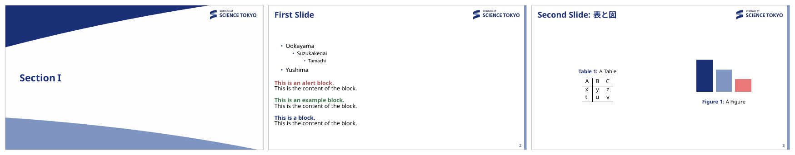

# Science Tokyo Beamer Theme
<p align="center">


</p>

A Beamer theme that follows the official PowerPoint templates A to D of Institute of Science Tokyo.
It is derived from the [Tokyo Tech-flavored Metropolis theme](https://github.com/oyamay/beamertheme-titech) by Yosuke Oyama, which is based on [Metropolis](https://github.com/matze/mtheme).

The logos and the background images belong to Institute of Science Tokyo. This repository does not include them.

# Add the Official Images
Download the official Science Tokyo PowerPoint templates A to D and run

```
cd /path/to/this/repository
./extract_pptx_images.sh /path/to/templates/*.pptx
```

The script reads the variant from each template, so the file names do not matter, and copies the logos and the backgrounds into `img/`.
Without them, the theme draws the bands with TikZ and sets the logo as text.
The `noimg` option uses this fallback even when the images are present.

# Use the Theme
`main.tex` is a sample deck. Build it with `latexmk -lualatex -outdir=build main.tex`, or on Overleaf: upload the files of this repository together with the `img/` folder to the top level of a project, and set the compiler to LuaLaTeX.

For another document, put the `.sty` files and the `img/` folder next to it, or put this directory on the TeX search path together with its subdirectories (for example, `TEXINPUTS=.:/path/to/this/repository//:`).
Then load the theme:

```latex
\documentclass[aspectratio=169]{beamer}
\usepackage[haranoaji,deluxe]{luatexja-preset} % Japanese with LuaLaTeX
\usetheme[variant=A]{sciencetokyo}

\title{Presentation Title}
\author{Name}
\institute{Position and Affiliation}
\date{Event Name, Date}
```

`\date` fills the slot for the event name and the date on the title page.
Call `\maketitle` outside a frame, so that the title page gets no frame number and no progress bar.

The theme works with LuaLaTeX, XeLaTeX, pdfLaTeX, and pLaTeX.
With LuaLaTeX and XeLaTeX, Latin text uses Fira Sans, or Noto Sans when Fira Sans is missing.
Japanese text uses the Gothic family.

# Options

| Option | Values | Effect |
|---|---|---|
| `variant` | `A` (default), `B`, `C`, `D` | Design of the title page and the section pages |
| `sectionpage` | `strong` (default), `pale`, `none` | Background of the page that opens each section |
| `subsectionpage` | `strong`, `pale`, `none` (default) | Background of the page that opens each subsection |
| `logo` | `wide` (default), `stacked` | Logo at the top right of ordinary frames |
| `numbering` | `counter` (default), `fraction`, `none` | Frame number |
| `progressbar` | `none` (default), `head`, `frametitle`, `foot` | Position of the progress bar |
| `block` | `transparent` (default), `fill` | Background of blocks |
| `noimg` | | Draws the fallback instead of the official images |

To change an option in the middle of a document, use `\sciencetokyoset`, for example `\sciencetokyoset{sectionpage=pale}`.
A frame with the `standout` option has a navy background and centered text.

The colors of the official templates are available as `STnavy`, `STlightblue`, `STred`, `STorange`, `STyellow`, `STgreen`, `STdarkgreen`, and `STgray`.

---

This work is licensed under a Creative Commons Attribution-ShareAlike 4.0 International License (https://creativecommons.org/licenses/by-sa/4.0/).
